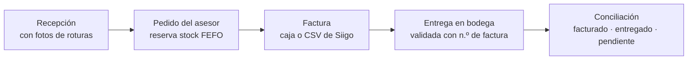

# Decor Cerámicas · Control de bodega, entregas y facturas

Demostración de un WMS pensado para un distribuidor de **cerámica, porcelanato, revestimientos y adhesivos**. Nace de una necesidad puntual que dejó la reunión de requerimientos:

> **Lo que sale físicamente de la bodega no coincide con lo que se factura**, y los cuadernos y sellos manuales permiten fraudes.

La respuesta del sistema es una regla simple: **sin factura vigente no hay entrega**, y todo lo facturado se concilia contra lo entregado.

---

## El flujo completo



| Paso | Pantalla                    | Quién                     | Qué garantiza                                                                                              |
| ---- | --------------------------- | ------------------------- | ---------------------------------------------------------------------------------------------------------- |
| 1    | **Recepción de mercadería** | Operario                  | Cantidad recibida, dañada y faltante; **foto obligatoria** si hay roturas; reclamo automático al proveedor |
| 2    | **Pedidos y facturas**      | Asesor                    | Pedido con precio y descuento máximo; stock reservado por FEFO                                             |
| 3    | **Pedidos y facturas**      | Caja                      | Número de factura + medio de pago, o **carga del CSV de Siigo** con revisión previa                        |
| 4    | **Entrega en bodega**       | Operario / Jefe de bodega | Solo se entrega con factura vigente; entregas parciales con saldo; quién retira y quién entrega            |
| 5    | **Conciliación**            | Gerencia / Jefe / Caja    | Facturado vs entregado vs pendiente, y alertas de diferencias                                              |

Las alertas de **Conciliación** señalan: facturas anuladas con mercancía ya entregada, facturas sin retirar hace más de 7 días y pedidos sin factura que mantienen stock bloqueado.

---

## Perfiles

| Perfil                   | Qué hace                                                                                          |
| ------------------------ | ------------------------------------------------------------------------------------------------- |
| **Administrador**        | Todo, incluida la configuración, usuarios y catálogo                                              |
| **Jefe de Bodega**       | Supervisa inventario, entregas, reclamos y conteos; aprueba bajas y ajustes hasta **$ 1.200.000** |
| **Operario de Bodega**   | Recibe, entrega pedidos facturados, despacha traspasos, reporta daños y hace conteos ciegos       |
| **Asesor comercial**     | Consulta existencias y precios, crea pedidos y sigue sus entregas                                 |
| **Cajero / Facturación** | Factura pedidos, registra el medio de pago, carga el CSV de Siigo y anula facturas                |
| **Gerencia**             | Solo lectura; aprueba bajas y ajustes **sobre $ 1.200.000**                                       |

Cada movimiento queda registrado **a nombre de la persona** que lo hizo, no del perfil.

---

## Probar la demostración

1. Instala y arranca (ver más abajo) y abre la app: te pide ingresar.
2. En la pantalla de ingreso elige un usuario de demostración (todos usan la clave **`1234`**). Desde el menú de la persona puedes **cambiar de usuario** para ver cómo cambia la experiencia por perfil.
3. Recorrido sugerido:
   - **Caja** (`Natalia Cano`) → _Pedidos y facturas_ → «Cargar facturas de Siigo» → «Usar archivo de ejemplo».
   - **Operario** (`Camilo Rojas`) → _Entrega en bodega_ → busca `FV-10447` y entrega parcialmente.
   - **Gerencia** (`Sofía Londoño`) → _Conciliación_: la factura `FV-10441` aparece como crítica (anulada con mercancía entregada).
4. Los datos se guardan en el navegador. En **Configuración → Usuarios → Demostración** se pueden restablecer.

### Cargar facturas de Siigo

Siigo es un sistema cerrado y no tiene conexión directa: las facturas del día se exportan en **CSV** y se cargan en _Pedidos y facturas_. El sistema detecta el separador (coma, punto y coma o tabulación) y las columnas por nombre:

| Columna                                            | Uso                                                                          |
| -------------------------------------------------- | ---------------------------------------------------------------------------- |
| `factura` · `sku` · `cantidad`                     | Obligatorias                                                                 |
| `fecha` · `nit` · `cliente`                        | Recomendadas                                                                 |
| `precio` · `bodega` · `medio de pago` · `vendedor` | Opcionales (si faltan se usa el precio del catálogo y la bodega activa)      |
| `unidad`                                           | Si viene en m² o kg, se convierte a cajas o sacos con el factor del producto |
| `estado`                                           | «Anulada» anula la factura si ya estaba cargada                              |

Antes de cargar se muestra una revisión: facturas listas, omitidas (ya cargadas) y con error (SKU inexistente, stock insuficiente). En **Configuración → Facturación** hay un archivo de ejemplo descargable.

---

## Estructura contratada

El sistema soporta tres casos de estructura (se cambian en _Configuración → Bodegas_):

1. **Caso 1**: 1 almacén con 1 bodega.
2. **Caso 2**: 1 almacén con 2 bodegas.
3. **Caso 3**: casa matriz con 2 almacenes y 4 bodegas.

Cada usuario ve solo las bodegas a las que tiene acceso.

---

## Stack

- [React 19](https://react.dev/) + [Vite](https://vitejs.dev/)
- [TanStack Router](https://tanstack.com/router)
- [Tailwind CSS 4](https://tailwindcss.com/) + [shadcn/ui](https://ui.shadcn.com/)
- [Vitest](https://vitest.dev/) en modo navegador (Playwright)

Es una **demostración sin servidor**: los datos viven en el navegador (`localStorage`). El dominio (`src/features/wms/domain`) es lógica pura y está cubierto por pruebas, lo que facilita llevarlo a un servicio real.

## Inicio rápido

```bash
npm install
npm run dev          # http://localhost:5173
```

```bash
npm run build        # tipos + compilación
npm run lint
npm run test:browser:install   # una sola vez: instala Chromium para las pruebas
npm test
```

## Despliegue

Cada push a `main` publica la imagen en GHCR y redespliega en Easypanel (GitHub Actions). La guía de configuración, paso a paso, está en [`docs/DESPLIEGUE.md`](./docs/DESPLIEGUE.md).

## Documentación

En [`docs/`](./docs):

- [`DESPLIEGUE.md`](./docs/DESPLIEGUE.md): publicación automática con GitHub Actions y Easypanel.
- [`AVANCE_PLAN_GENERAL.md`](./docs/AVANCE_PLAN_GENERAL.md): estado frente a las notas de la reunión, matriz de pantallas y perfiles, y pendientes.
- [`PRODUCT.md`](./docs/PRODUCT.md): propósito, usuarios y principios de producto.
- [`DESIGN.md`](./docs/DESIGN.md): sistema de diseño (superficies planas, color solo para estado, móvil primero).
