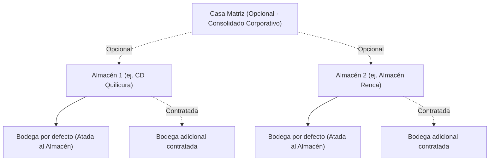

# WMS Esencial · Plataforma de Visibilidad y Control de Mercancía

Plataforma WMS enfocada en operaciones medianas de **materiales de construcción, cerámica, porcelanatos, adhesivos y revestimientos**. Diseñada con **7 módulos, 16 pantallas y 4 perfiles** para eliminar las zonas ciegas sobre la mercadería: qué está en existencia, por entregar (retiro en bodega), dañado, por reclamar, rezagado/por vencer y perdido.

---

## 🏗️ Jerarquía Organizacional y Comercial

El sistema implementa una arquitectura jerárquica flexible adaptada a planes SaaS:



### Casos de Uso Contratados Soportados
1. **Caso 1**: Sin Casa Matriz · 1 Almacén con 1 Bodega atada por defecto.
2. **Caso 2**: Sin Casa Matriz · 1 Almacén con 2 Bodegas (1 atada por defecto + 1 adicional contratada).
3. **Caso 3**: Con Casa Matriz · 2 Almacenes, cada uno con su Bodega atada por defecto + 1 Bodega adicional contratada (4 bodegas en total).

> **Aprovisionamiento**: Todo Almacén incluye por defecto una Bodega atada. Las altas de Casa Matriz, Almacenes y Bodegas se gestionan en el sistema comercial externo de suscripciones. En el WMS se administran los parámetros operativos (horarios, cortes de camiones y jefatura).

---

## ✨ Características Principales (v2.0.0 · WMS Esencial)

- **Mapa de Mercancía (6 Bloques sin Doble Conteo)**: En existencia, Por entregar, Dañada, Por reclamar, Rezagada/por vencer y Perdida confirmada del mes.
- **Control Simplificado por Partida (SKU + Bodega + Vencimiento FEFO)**: Sin complejidad de Tono/Calibre ni ubicaciones Pasillo-Rack-Bin.
- **5 Estados Físicos Excluyentes**: Disponible, Reservado, Dañado, En reclamo y En tránsito.
- **Salidas por Retiro en Bodega**: Carga manual o importación CSV con reserva FEFO automática, alerta de pedidos sin retirar (> 7 días) y mostrador de retiro total o parcial.
- **Control de Pérdidas y Conteos Ciegos**: Registro de daños con evidencia, conteos ciegos y aprobación dual por umbral (**JB ≤ USD 300 · GER > USD 300**).
- **Reclamos y Rezagados**: Apertura automática de reclamo a proveedor en recepción con diferencias, devoluciones de clientes y monitoreo de rezagados (≥ 60/90 días) y vencimientos (≤ 30 días).
- **4 Perfiles RBAC**: Administrador (`ADM`), Jefe de Bodega (`JB`), Operario de Bodega (`OPE`) y Gerencia (`GER`).

---

## 🛠️ Stack Tecnológico

- **Frontend**: [React 19](https://react.dev/)
- **Build Tool**: [Vite](https://vitejs.dev/)
- **Enrutamiento**: [TanStack Router](https://tanstack.com/router)
- **Estilos**: [Tailwind CSS](https://tailwindcss.com/)
- **Componentes**: [Shadcn UI](https://ui.shadcn.com/) + Radix UI
- **Iconografía**: [Lucide React](https://lucide.dev/)
- **Notificaciones**: [Sonner](https://sonner.emilkowal.ski/)

---

## 🚀 Inicio Rápido

### Requisitos Previos
- Node.js 18+
- npm o pnpm

### Instalación y Ejecución

```bash
# Clonar el repositorio
git clone https://github.com/sadian88/wms-demo.git
cd wms-demo

# Instalar dependencias
npm install
# o con pnpm
pnpm install

# Iniciar servidor de desarrollo
npm run dev
```

La aplicación estará disponible en `http://localhost:5173` (o el puerto indicado en la terminal).

---

## 📂 Documentación del Proyecto

En la carpeta [`docs/`](./docs) encontrarás:
- [`AVANCE_PLAN_GENERAL.md`](./docs/AVANCE_PLAN_GENERAL.md): Estado de avance del plan general, matriz de módulos implementados y próximos pasos.
- [`PRODUCT.md`](./docs/PRODUCT.md): Especificación funcional detallada, modelo de datos y reglas de negocio de cerámica.
- [`DESIGN.md`](./docs/DESIGN.md): Sistema de diseño, paleta cromática de estados de stock y lineamientos de UX.
- `Menu_Pantallas_y_Roles_WMS.xlsx`: Matriz original de pantallas y roles RBAC autorizados.
- `Especificación Funcional Detallada – Plataforma WMS Inventario Despachos TMS Ligero.docx`: Documento de especificación funcional completa.
