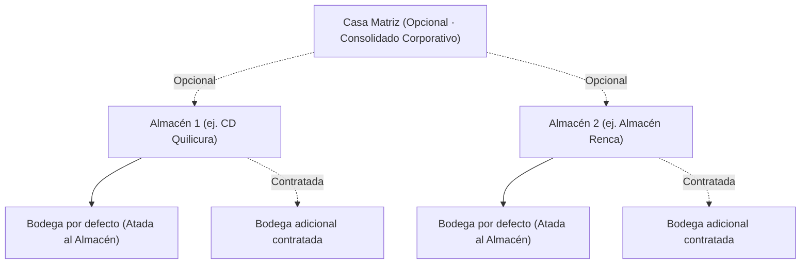

# WMS Demo · Plataforma de Gestión de Almacenes y Bodegas

Demo interactiva de WMS para pymes del sector de **cerámica, porcelanatos, revestimientos y materiales de construcción**. Diseñada para resolver los problemas críticos del rubro: control estricto de **Tono y Calibre**, trazabilidad por lote/partida, y gestión jerárquica multi-almacén.

---

## 🏗️ Jerarquía Organizacional y Comercial

El sistema implementa una arquitectura jerárquica flexible adaptada a planes SaaS:



### Casos de Uso Contratados Soportados
1. **Caso 1**: Sin Casa Matriz · 1 Almacén con 1 Bodega atada por defecto.
2. **Caso 2**: Sin Casa Matriz · 1 Almacén con 2 Bodegas (1 atada por defecto + 1 adicional contratada).
3. **Caso 3**: Con Casa Matriz · 2 Almacenes, cada uno con su Bodega atada por defecto + 1 Bodega adicional contratada (4 bodegas en total).

> **Aprovisionamiento**: Todo Almacén incluye por defecto una Bodega atada. Las altas de Casa Matriz, Almacenes y Bodegas se gestionan en el sistema comercial externo de suscripciones. En el WMS se administran los parámetros operativos (horarios, cortes de camiones y jefatura).

---

## ✨ Características Principales

- **Control de Tono y Calibre**: Previene mezclas de partidas en picking y packing cerámico.
- **8 Estados Físicos de Stock**: Disponible, Reservado, Cuarentena, Bloqueado, Merma, Tránsito interbodega, Muestra y Obra (sin doble conteo).
- **Cálculo Riguroso de ATP**: Stock prometible descontando reservas y sumando órdenes de compra en tránsito.
- **Putaway Dirigido**: Reglas de asignación inteligente a nivel de piso para pallets pesados de cerámica y morteros.
- **Traspasos Inter-Bodegas**: Ciclo completo Solicitado → Aprobado → En tránsito → Recibido con control de guías electrónicas y diferencias de rotura.
- **Matriz de Roles RBAC**: 6 perfiles operativos (Administrador, Jefe de Bodega, Recepción, Operario Picking, Control Calidad, Gerencia/Ventas).
- **Selector Jerárquico en Header y Sidebar**: Cambio dinámico entre vista consolidada, almacén específico o bodega individual.

---

## 🛠️ Stack Tecnológico

- **Frontend**: [React 19](https://react.dev/)
- **Build Tool**: [Vite](https://vitejs.dev/)
- **Enrutamiento**: [TanStack Router](https://tanstack.com/router)
- **Estilos**: [Tailwind CSS](https://tailwindcss.com/)
- **Componentes**: [Shadcn UI](https://ui.shadcn.com/) + Radix UI
- **Iconografía**: [Lucide React](https://lucide.dev/)
- **Notificaciones**: [Sonner](https://sonner.emilkowal.ski/)

---

## 🚀 Inicio Rápido

### Requisitos Previos
- Node.js 18+
- npm o pnpm

### Instalación y Ejecución

```bash
# Clonar el repositorio
git clone https://github.com/sadian88/wms-demo.git
cd wms-demo

# Instalar dependencias
npm install
# o con pnpm
pnpm install

# Iniciar servidor de desarrollo
npm run dev
```

La aplicación estará disponible en `http://localhost:5173` (o el puerto indicado en la terminal).

---

## 📂 Documentación Adicional

En la carpeta [`docs/`](./docs) encontrarás:
- [`PRODUCT.md`](./docs/PRODUCT.md): Especificación funcional detallada, modelo de datos y reglas de negocio.
- [`DESIGN.md`](./docs/DESIGN.md): Sistema de diseño, paleta cromática de estados de stock y lineamientos de UX.
