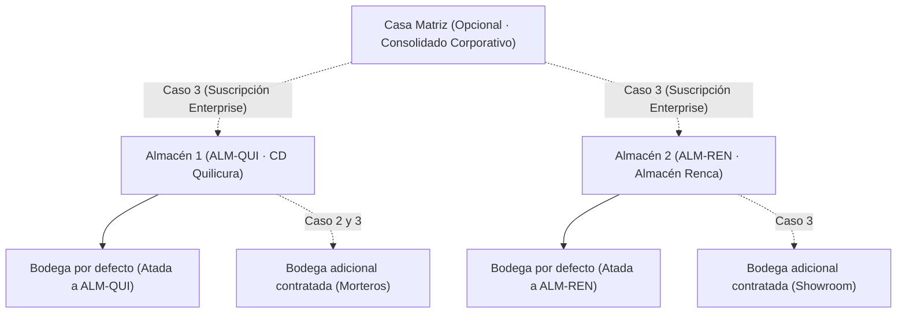

# Estado de Avance del Plan General · Plataforma WMS

**Proyecto:** WMS e Inventario para Pymes de Cerámica, Porcelanato y Materiales de Construcción  
**Fecha de corte:** Octubre 2026  
**Versión de la demo:** 1.0.0  

---

## 1. Visión y Alcance del Sistema

La plataforma WMS está diseñada para resolver los desafíos operativos críticos de distribuidores y comercializadores de cerámica, porcelanatos, revestimientos y adhesivos:
1. **Control estricto de Tono y Calibre**: Impedir que un pedido despache cajas de tonalidades o calibres diferentes que arruinen la instalación en obra.
2. **8 Estados físicos de inventario sin doble conteo**: Disponible, Reservado, Cuarentena, Bloqueado, Merma, Tránsito interbodega, Muestra y Obra.
3. **Cálculo de ATP riguroso**: Prometible real = Stock Físico - Reservas Obra/Web + Órdenes de Compra en Tránsito.
4. **Putaway Dirigido**: Ubicación a nivel piso para pallets pesados (>30 kg/caja) y segregación de adhesivos en ambientes secos (regla FEFO).
5. **Topología Multi-Almacén y Multi-Bodega**: Adaptada a contratos SaaS de 1 o múltiples puntos de almacenamiento.

---

## 2. Jerarquía Organizacional y Aprovisionamiento Comercial

El sistema implementa la jerarquía física y comercial acordada:

### Reglas de Aprovisionamiento Comercial
- **Bodega Atada**: Todo Almacén físico provisionado incluye por defecto 1 Bodega operativa principal (`isDefaultTied: true`).
- **Bloqueo de Creación en WMS**: Desde el WMS no se permite crear Casa Matriz, Almacenes ni Bodegas, ya que su tarificación y alta corresponden al sistema comercial externo de venta y suscripciones.
- **Parámetros Operativos Editables**: Dentro del WMS, los usuarios autorizados (Administrador / Jefe de Bodega) pueden editar únicamente los parámetros operativos de cada entidad (horarios, hora de corte de camiones y jefe de bodega responsable).

### Los 3 Casos de Uso Contratados Soportados
1. **Caso 1 (`CASE_1`)**: Sin Casa Matriz · 1 Almacén (`ALM-QUI`) con 1 Bodega atada por defecto (`BOD-CEN-01`).
2. **Caso 2 (`CASE_2`)**: Sin Casa Matriz · 1 Almacén (`ALM-QUI`) con 2 Bodegas (`BOD-CEN-01` atada por defecto + `BOD-MOR-04` adicional contratada).
3. **Caso 3 (`CASE_3`)**: Con Casa Matriz (`Casa Matriz Ceramix Constructora`) · 2 Almacenes (`ALM-QUI` y `ALM-REN`), cada uno con su bodega atada por defecto + 1 bodega adicional (4 bodegas en total).

---

## 3. Matriz de Avance por Módulo

| Módulo | Nombre | Pantallas | Estado | Descripción Funcional |
|---|---|---|---|---|
| **M1** | **Torre de Control Operativa** | 1.1, 1.2, 1.3 | **100% Funcional** | Embudo de pedidos del día, KPIs operativos de descarga y merma, y monitor de alertas críticas en vivo. |
| **M2** | **Almacenes, Bodegas y Ubicaciones** | 2.1, 2.2, 2.3, 2.4, 2.5 | **100% Funcional** | Consolidado multi-bodega con desglose de 8 estados, gestión de almacenes provisionados, mapa visual de 8 zonas funcionales, simulador de putaway dirigido con bullet charts mín/máx, y ciclo de traspasos inter-bodegas con guías electrónicas. |
| **M3** | **Recepción e Inspección** | 3.1 – 3.5 | **Vista Operativa + RBAC** | Descarga de contenedores, pesaje, verificación de Tono/Calibre y entrada a cuarentena. |
| **M4** | **Gestión de Stock y Trazabilidad** | 4.1 – 4.7 | **Vista Operativa + RBAC** | Ficha de lote cerámico, saldo de tono AIP, mermas por rotura y bloqueo preventivo. |
| **M5** | **Demanda y Asignación de Stock** | 5.1 – 5.5 | **Vista Operativa + RBAC** | Reserva dura por proyecto/obra, backorder y cálculo de ATP prometible. |
| **M6** | **Compras y Reabastecimiento** | 6.1 – 6.5 | **Vista Operativa + RBAC** | Sugerencia de compra por pallet cerrado y seguimiento de OC en tránsito de importación. |
| **M7** | **Preparación y Despachos** | 7.1 – 7.6 | **Vista Operativa + RBAC** | Olas de picking por mismo tono/calibre, packing con zunchado y muelle de salida. |
| **M8** | **Transporte y Última Milla (TMS)** | 8.1 – 8.7 | **Vista Operativa + RBAC** | Flota de camiones pluma/rampa, generación de guías fiscales y tracking a obra. |
| **M9** | **Devoluciones de Clientes (RMA)** | 9.1 – 9.4 | **Vista Operativa + RBAC** | Recepción de cajas sobrantes de obra, verificación de tono original y reintegro al stock. |
| **M10** | **Mermas, Rezagados y Calidad** | 10.1 – 10.7 | **Vista Operativa + RBAC** | Bajas de palmetas rotas, inventario cíclico por pasillo y control FEFO de químicos. |
| **M11** | **Configuración y Contexto** | 11.1, 11.2, 11.3, 11.9 | **100% Funcional** | SideNav con simulación en vivo de los 3 casos de topología comercial, selección jerárquica de bodega activa, cambio de perfiles RBAC con candados visuales, y selector de fuentes nativas suaves. |

---

## 4. Matriz de Roles Operativos (RBAC)

El menú y los permisos se adaptan automáticamente al perfil seleccionado:

1. **Superusuario (`ALL`)**: Acceso total e irrestricto a los 11 módulos.
2. **Administrador (`ADM`)**: Configuración general, catálogo, topología y usuarios.
3. **Jefe de Bodega (`JB`)**: Supervisión operativa, aprobación de traspasos, olas de picking y ajustes.
4. **Recepción (`REC`)**: Descarga, ingreso de OC, cuarentena inicial y conteos.
5. **Operario Picking / Grúa (`PCK`)**: Preparación guiada por tono, putaway dirigido y reabastecimiento de bins.
6. **Packing y Despacho (`PKG`)**: Zunchado, pesado, control de bultos y carga en andén.
7. **Control de Calidad (`CAL`)**: Verificación técnica de tonalidad, calibración y reclamos RMA.
8. **Transporte (`TRA`)**: Asignación de camiones, guías de despacho y monitoreo de entrega en obra.
9. **Gerencia / Ventas (`GER`)**: Visión consolidada corporativa, KPIs y consulta de ATP prometible.

---

## 5. Próximos Pasos de la Hoja de Ruta

1. **Fase 2 - Operación en Terminales Móviles**:
   - Implementar interfaz táctil de alta densidad para terminales industriales RF (escaneo de código de barras GS1-128 / LPN).
2. **Fase 3 - Conectores ERP y Facturación Electrónica**:
   - Webhooks para sincronización bidireccional de pedidos de venta y emisión automática de Guías de Despacho del SII.
3. **Fase 4 - Optimización de Rutas TMS**:
   - Algoritmo de cubicaje y consolidación de carga en camiones pluma por peso por eje y restricciones comunales.
