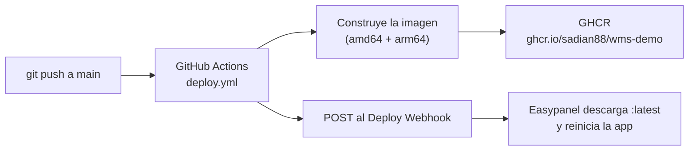

# Despliegue automático · GitHub Actions + Easypanel

Cada push a `main` publica una imagen nueva y le avisa a Easypanel para que la descargue y reinicie la aplicación. Es el mismo esquema que usa `mercy-studio`.



| Pieza | Archivo |
|---|---|
| Workflow | [`.github/workflows/deploy.yml`](../.github/workflows/deploy.yml) |
| Imagen | [`Dockerfile`](../Dockerfile): compila con Vite y sirve con nginx en el puerto **8080** |
| nginx | [`deploy/nginx.conf`](../deploy/nginx.conf): rutas de la SPA, caché y `/healthz` |

La aplicación es **estática** (los datos de la demostración viven en el navegador), así que en Easypanel **no se necesita volumen ni variables de entorno**.

---

## Configuración única

### 1. En GitHub (repositorio `sadian88/wms-demo`)

Se necesita un usuario con permiso de administrador del repositorio.

1. **Settings → Environments → New environment** → nombre exacto: `production`. (Opcional: agregar *Required reviewers* si quieres aprobar cada despliegue.)
2. Dentro de `production` → **Environment secrets → Add secret**:
   - Nombre: `EASYPANEL_DEPLOY_URL`
   - Valor: la URL del *Deploy Webhook* de la app (se obtiene en el paso 2.6).
3. **Settings → Actions → General → Workflow permissions**: si el primer despliegue falla con `permission_denied: write_package`, activa *Read and write permissions*.

### 2. En Easypanel

1. Entra al panel y crea (o elige) un **Project**, por ejemplo `decor-ceramicas`.
2. **+ Service → App**, con el nombre `wms-demo`.
3. **Source → Docker Image**: `ghcr.io/sadian88/wms-demo:latest`.
   - Si el paquete de GHCR es **público** no hace falta nada más.
   - Si es **privado**, completa *Username* (`sadian88`) y *Password* con un *Personal Access Token (classic)* con permiso `read:packages`.
4. **Domains → Add domain**:
   - *Host*: el dominio que usarán (por ejemplo `wms.tudominio.com`) o el que Easypanel genera.
   - **Port: `8080`**
   - HTTPS activado.
   - Si usas un dominio propio, crea en tu DNS un registro **A** hacia la IP del servidor.
5. **Environment** y **Mounts**: se dejan vacíos.
6. **Deploy Webhook**: en la pestaña *Deployments* de la app (en algunas versiones está en *Source*) copia la URL del *Deploy Webhook* y guárdala en el secret `EASYPANEL_DEPLOY_URL` de GitHub (paso 1.2).

### 3. Primer despliegue

1. En GitHub: **Actions → Deploy a producción → Run workflow** (o haz un push a `main`).
2. Cuando el job *Construir y publicar imagen* termine, ve a tu perfil de GitHub → **Packages → wms-demo → Package settings → Change visibility → Public** (si no quieres usar el token del paso 2.3).
3. En Easypanel pulsa **Deploy** en la app (solo esta primera vez; después lo dispara el webhook).
4. Comprueba: `https://tu-dominio/version.txt` debe mostrar el SHA del commit desplegado, y `https://tu-dominio/healthz` responde `ok`.

> La imagen tiene que existir en GHCR antes de que Easypanel intente descargarla: por eso el orden es primero el workflow y luego *Deploy*.

---

## Operación diaria

- **Desplegar**: hacer push a `main`. Tarda unos minutos (construcción + descarga).
- **Ver qué versión está en línea**: `/version.txt`.
- **Volver a una versión anterior**: en Easypanel cambia la imagen a `ghcr.io/sadian88/wms-demo:<sha-del-commit>` y pulsa *Deploy*. Cada despliegue deja una etiqueta con su SHA.
- **Probar la imagen en tu equipo**:

  ```bash
  docker build -t wms-demo .
  docker run --rm -p 8080:8080 wms-demo      # http://localhost:8080
  ```

## Si algo falla

| Síntoma | Causa probable | Qué hacer |
|---|---|---|
| El job *deploy* dice `Falta el secret EASYPANEL_DEPLOY_URL` | El secret no está en el environment `production` | Crearlo ahí (no como secret de repositorio) |
| `curl: (22) … 404` o `401` en *Disparar redeploy* | URL del webhook incorrecta o regenerada | Copiarla de nuevo desde Easypanel |
| Easypanel: `pull access denied` / `unauthorized` | El paquete de GHCR es privado | Hacerlo público o poner usuario + token `read:packages` en *Source* |
| Easypanel: `no matching manifest for linux/arm64` | La imagen no se publicó para esa arquitectura | Ya se publica amd64 + arm64; vuelve a correr el workflow |
| `permission_denied: write_package` en el job *build* | Permisos de Actions limitados | Paso 1.3 |
| Al recargar `/wms/4-2` aparece 404 | nginx sin respaldo a `index.html` | Ya está en `deploy/nginx.conf`; verifica que la app usa esta imagen |
| 502 / *Service is not reachable* | Puerto del dominio distinto de 8080 | Corregir el puerto en *Domains* |

## Importante

- El despliegue **no espera** a `ci.yml` (lint, formato y pruebas): igual que `mercy-studio`. Sí falla si hay errores de tipos o de compilación, porque la imagen ejecuta `pnpm build`.
- Esta versión no tiene servidor ni base de datos: cada navegador guarda sus propios datos. Cuando exista una API, se agregaría otro servicio en el mismo proyecto de Easypanel (y un volumen si guarda archivos).
